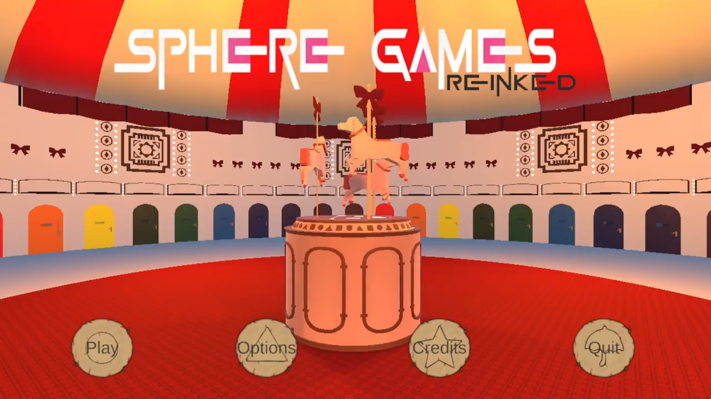
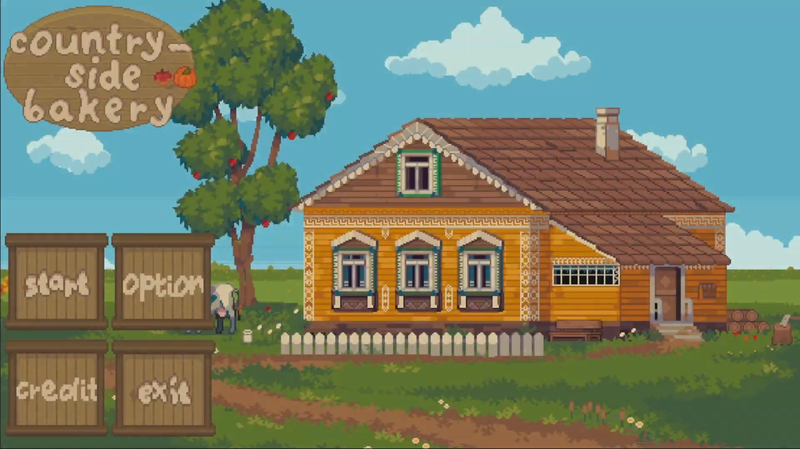
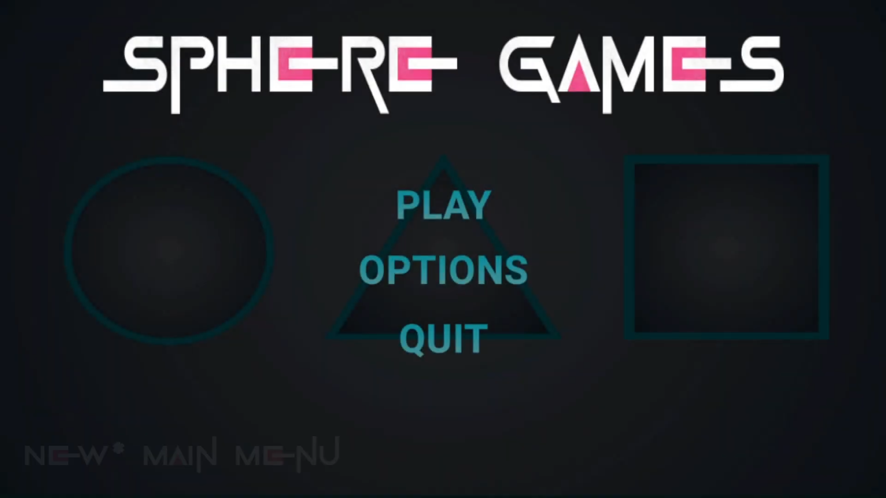
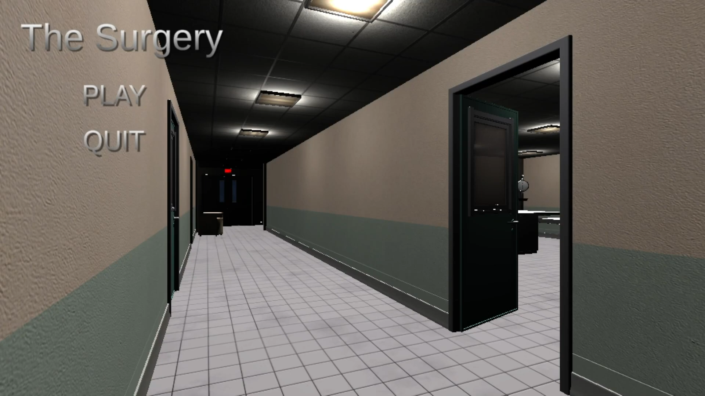
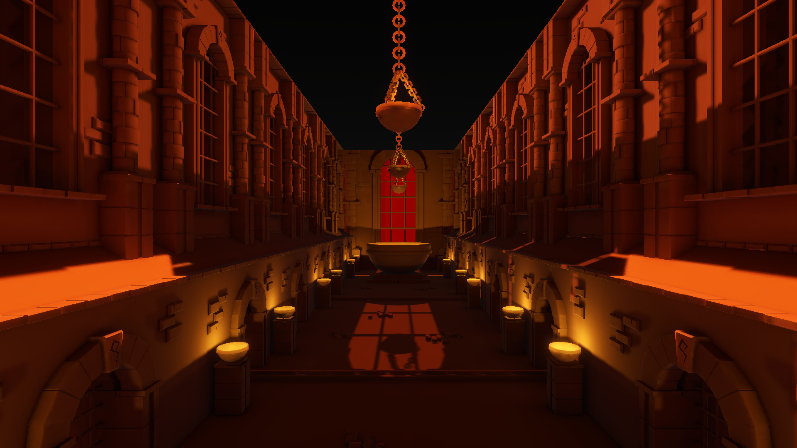
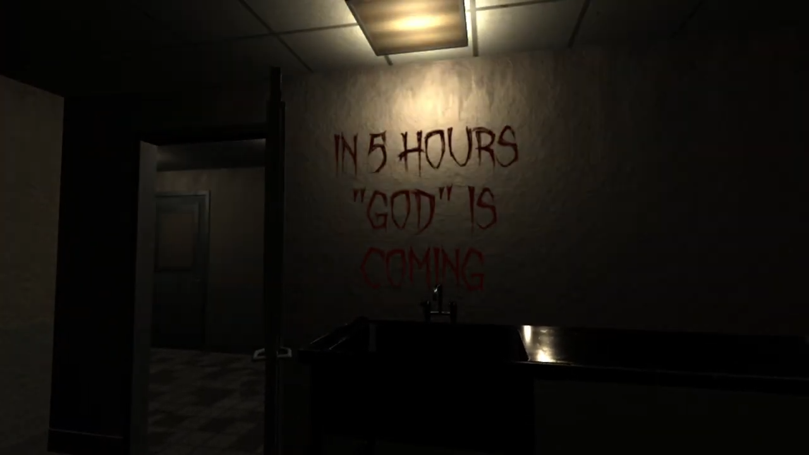
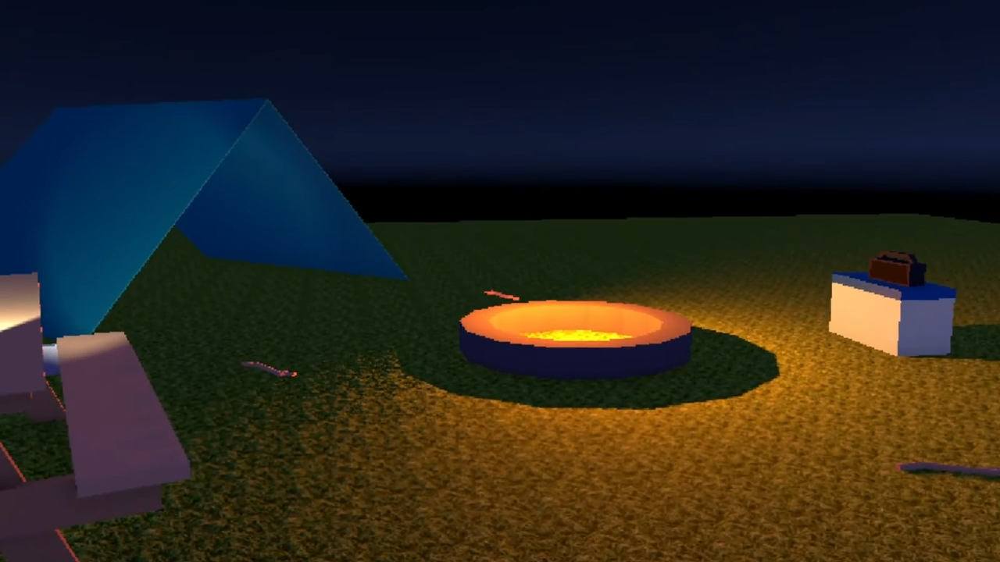
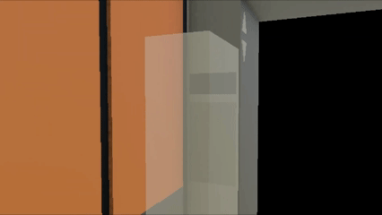

## About Me 
Hey, I'm Xander. I'm currently a second-year student at NSCC Truro, studying Game Programming.

I started making games when I was 11 using Scratch, and have since moved on to C# and Unity. Since then, I've worked on a variety of projects, ranging from 2D and 3D Unity games to simple console programs. I mainly use C# and the unity engine.

During my studies, I'm mainly focused on improving my programming skills and becoming more familiar with the Unity Editor.

## Languages & Tools I Know
### Languages

### Engines

### Developer Tools

## Current Projects
### [Sphere Games Re-Inked](https://github.com/Doeugh/RollABall2)
> **Built with:** Unity · C#
> 
> This project is a remaster of my old Sphere games project, based on Unity's Roll a Ball tutorial

Click to view more

)

> Sphere Games Re-Inked Dev Log Playlist

### [UnCloudy Valley](https://github.com/Doeugh/UnCloudyValley)
> **Built with:** Unity · C#
> 
> My current passion project

## Past Projects 
### [Country-Side Bakery](https://github.com/Doeugh/GameEngFinal) 
> **Built with:** Unity · C#
> 
> A small 2D game where the player collects ingredients for their bakery

Click to view more

> Full Gameplay Walkthrough for Country-Side Bakery

### [Sphere Games](https://github.com/Doeugh/Roll_A_Ball) 
> **Built with:** Unity · C#
> 
> A project based on Unity's Roll a Ball Tutorial

Click to view more

> Latest Update for Sphere Games

### [The Surgery](https://github.com/Doeugh/Triggered_Events)
> **Built with:** Unity · C#
> 
> A small horror game where the player navigates through an eerie hospital looking for organs

Click to view more

> Full Gameplay Walkthrough for The Surgery

### [Playable RPG](https://github.com/Doeugh/RPGPlayable)
> **Built with:** C#
> 
> A small console RPG game

## Media Links
### [YouTube Channel](https://www.youtube.com/@Xander-GameDev) 
> Main Channel

## Image Gallery

  
  
  
  

## Contact Me
Email me at DoucetteXander@gmail.com

<!--
**Xd0uc3tt3/Xd0uc3tt3** is a ✨ _special_ ✨ repository because its `README.md` (this file) appears on your GitHub profile.

Here are some ideas to get you started:

- 🔭 I’m currently working on ...
- 🌱 I’m currently learning ...
- 👯 I’m looking to collaborate on ...
- 🤔 I’m looking for help with ...
- 💬 Ask me about ...
- 📫 How to reach me: ...
- 😄 Pronouns: ...
- ⚡ Fun fact: ...
-->
